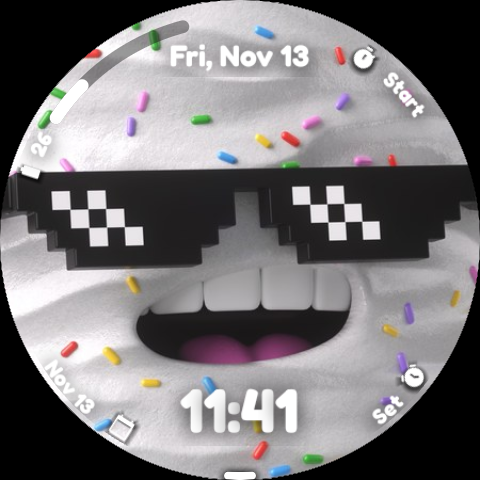
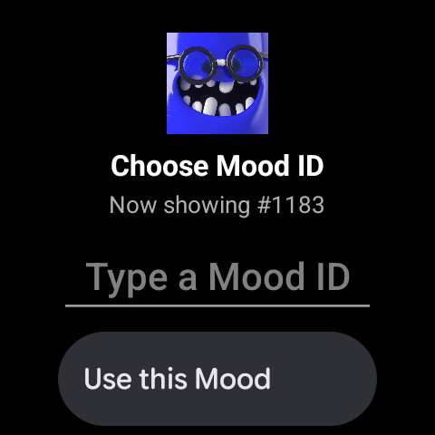
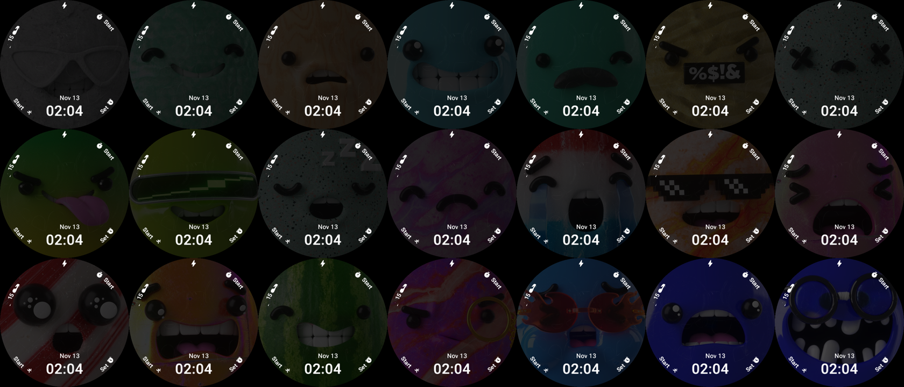
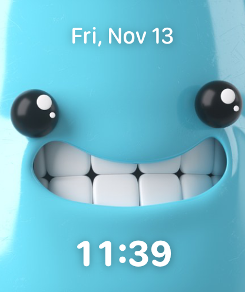
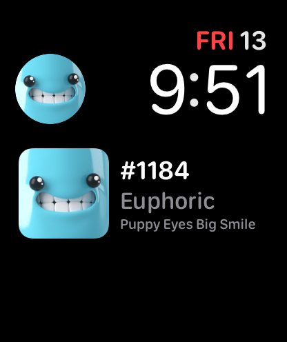
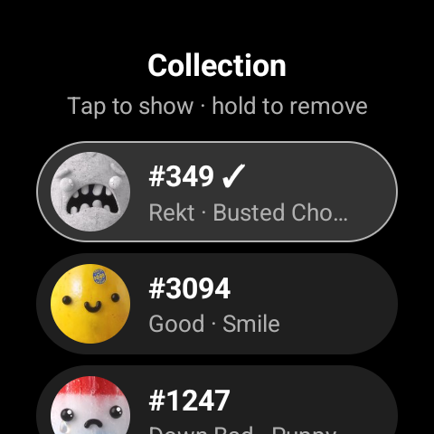
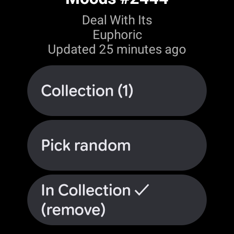
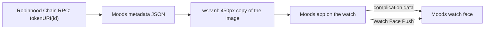

# MoodWatch

A Wear OS watch face that shows any **Moods** NFT from Robinhood Chain, full screen, and keeps it up to date every day. Type in a Mood's number on the watch; no wallet or account needed.

<p align="center">
  
  &nbsp;&nbsp;
  
</p>

## Features

- **Any Mood:** pick any token from the [Moods collection](https://robin.etherscan.io/address/0xa6ebbdfcfeafdc7a5a778d6fe514f45bd0a0133d) by its number. No wallet needed.
- **Collection:** save your favorite Moods and switch between them with one tap, or try a random one.
- **Daily refresh:** Moods change expression every day at 9:00 AM Pacific. The watch checks every minute from 9:00 to 9:15 AM and stops once the new image arrives.
- **Date and time:** the day and date sit at the top, and the time sits at the bottom, both in Fredoka.
- **Four bezel complications:** steps, battery, date, heart rate, or anything else your watch offers, styled after the stock Pixel faces.
- **Always-on display:** a dimmed copy of your Mood stays visible, within Wear OS's always-on brightness limit.
- **One install:** the Moods app installs the watch face itself, using Wear OS's Watch Face Push.
- **Works on LTE:** the app downloads over Wi-Fi, LTE, or your phone's Bluetooth connection.

<p align="center">
  
</p>

## Apple Watch

There's also an Apple Watch version in [`apple-watch/`](apple-watch/README.md): a Moods app with the same full-screen face, Collection and Pick random, plus complications for any watch face that has slots. Apple doesn't allow third-party watch faces, so you build it with Xcode and install it yourself.

<p align="center">
  
  &nbsp;&nbsp;
  
</p>

## Requirements

- A watch running **Wear OS 6 or newer**, such as Pixel Watch 3 or 4, or Galaxy Watch 8. Older versions can't receive watch faces through Watch Face Push.
- An internet connection on the watch (Wi-Fi, LTE, or a paired phone).

## Install

MoodWatch isn't on Google Play, so you install it yourself ("sideload") once.

1. Download `moods-app.apk` from the [latest release](../../releases/latest).
2. On the watch, turn on developer options: **Settings → System → About → Versions**, then tap **Build number** 7 times.
3. Turn on **Settings → Developer options → Wireless debugging**. Your watch and computer must be on the same Wi-Fi network.
4. Install the APK. Choose one of these ways:
   - **From a computer with [Android platform-tools](https://developer.android.com/tools/releases/platform-tools)**, in Terminal, from the folder where you downloaded the APK:
     ```sh
     # Tap "Pair new device" on the watch, then use the IP:port and code it shows
     adb pair 192.168.1.50:37000
     # Then connect, using the IP:port shown on the Wireless debugging screen
     adb connect 192.168.1.50:41000
     adb install moods-app.apk
     ```
   - **From an Android phone:** use a sideloading app such as *Wear Installer 2*, and follow its pairing steps.
5. Open **Moods** from the watch's app list. It installs the Moods watch face and asks to make it your watch face.

Optional, so the 9:00 AM refresh runs exactly on time (by default Wear OS may delay it by a few minutes). Run this from the same computer:

```sh
adb shell appops set com.moodwatch.app SCHEDULE_EXACT_ALARM allow
```

## Choosing a Mood

- **From the watch face:** touch and hold the face, tap **Edit**, tap the Mood in the middle, choose **Moods NFT**, type the Mood's number, and tap **Use this Mood**.
- **From the app:** open **Moods**, type a number, and tap **Show this Mood**.

The face keeps showing your current Mood until the new one has loaded. A number that doesn't exist shows "not found" and changes nothing.

To change the bezel complications, touch and hold the face, tap **Edit**, and tap any of the four corners.

## Collection and Pick random

<p align="center">
  
  &nbsp;&nbsp;
  
</p>

- **Save a Mood:** open **Moods** and tap **Add to Collection** to save the Mood on your face. Tap it again to remove it.
- **Switch:** tap **Collection**, then tap a thumbnail. The face changes to that Mood and the watch returns to the face. The current Mood has a ✓.
- **Remove:** in the Collection, touch and hold a Mood, then tap **Remove**.
- **Pick random:** tap **Pick random** to load a random Mood from the whole collection. If you like it, add it to your Collection.

Thumbnails are saved on the watch, so the Collection opens instantly. After the daily 9:00 AM Pacific change, each thumbnail refreshes the next time you open the Collection.

## How it works



The project has two modules:

| Module | What it is |
|---|---|
| `moods-app` | The Wear OS app, package `com.moodwatch.app`. It looks up the Mood with `tokenURI` on the contract, downloads a resized image, and serves it to the face as a complication. It schedules the 9:00 AM checks with an exact alarm, and installs or updates the bundled face through Watch Face Push. |
| `moods-face` | The watch face, written in [Watch Face Format](https://developer.android.com/training/wearables/wff) v2 and containing no code. Its package is `com.moodwatch.app.watchfacepush.moods`. The four bezel slots in `res/raw/watchface.xml` are generated by `moods-face/tools/gen_watchface.py`. |

The original Mood images are 2048 px and 2–5 MB, which is slow over a watch's connection. The app therefore downloads a 450 px copy (about 50 KB) through the free [wsrv.nl](https://wsrv.nl) image proxy, and falls back to the original image if the proxy fails. After the first lookup, the app remembers the metadata URL pattern and usually skips the chain call.

## Build from source

Requirements: Android Studio, or a JDK 17+ and the Android SDK (API 36).

```sh
git clone https://github.com/<you>/MoodWatch.git
cd MoodWatch
# Point Gradle at the Android SDK, e.g.:
echo "sdk.dir=$HOME/Library/Android/sdk" > local.properties
# Use Android Studio's bundled JDK (macOS path shown):
export JAVA_HOME="/Applications/Android Studio.app/Contents/jbr/Contents/Home"
./gradlew :moods-app:assembleDebug
adb install -r moods-app/build/outputs/apk/debug/moods-app-debug.apk
```

The build also builds `moods-face`, checks it with Google's Watch Face Push validator (`tools/validator-push-cli-*.jar`), and bundles it into the app. A face that fails validation stops the build.

### Release builds

Release builds read signing keys from `keystore.properties`, which git ignores. See [`keystore.properties.example`](keystore.properties.example). The face is signed with its own key, as Watch Face Push requires. Without that file, release builds fall back to the debug key.

```sh
mkdir -p release-keys
keytool -genkeypair -v -keystore release-keys/moods-upload.jks -storetype PKCS12 \
  -alias moods-upload -keyalg RSA -keysize 4096 -validity 10000 -dname "CN=Your Name"
keytool -genkeypair -v -keystore release-keys/moods-face.jks -storetype PKCS12 \
  -alias moods-face -keyalg RSA -keysize 4096 -validity 10000 -dname "CN=Your Name"
cp keystore.properties.example keystore.properties   # then fill in the passwords
./gradlew :moods-app:assembleRelease
```

## Disclaimer

MoodWatch is an unofficial fan project. It is not affiliated with, endorsed by, or sponsored by Good Vibes Club, the Moods collection, or Robinhood. Moods artwork belongs to its respective owners and is shown as published in each token's public metadata. The MIT license covers this project's code only, not the NFT artwork.

## License

[MIT](LICENSE)
