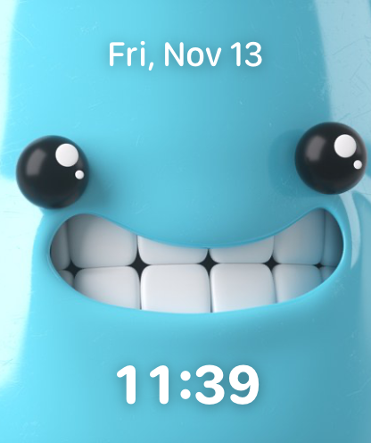
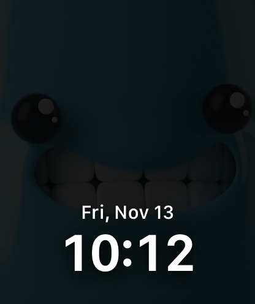
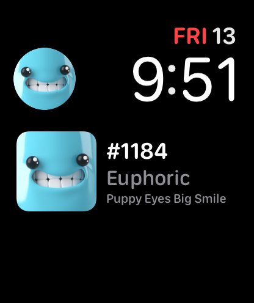
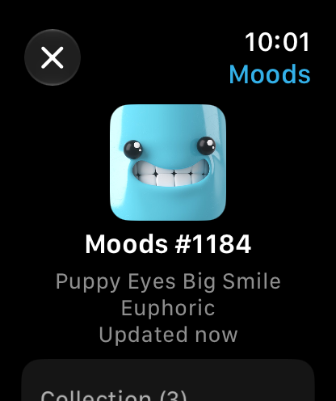
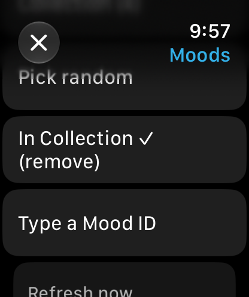
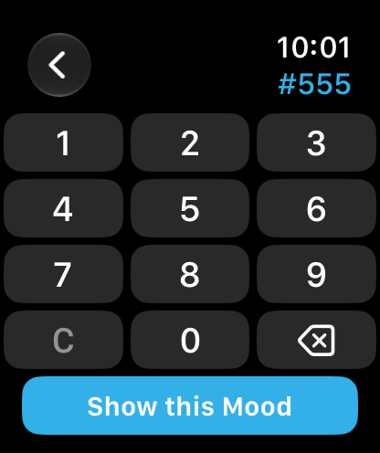
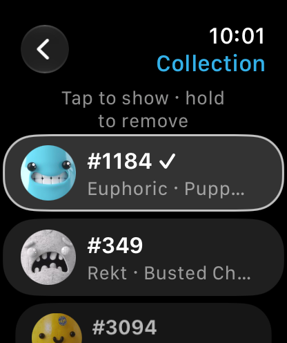
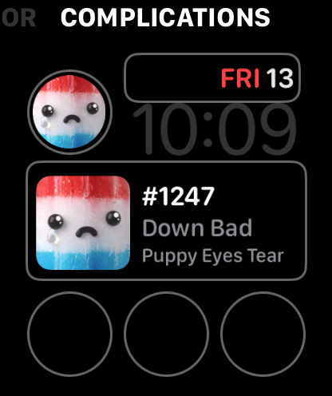
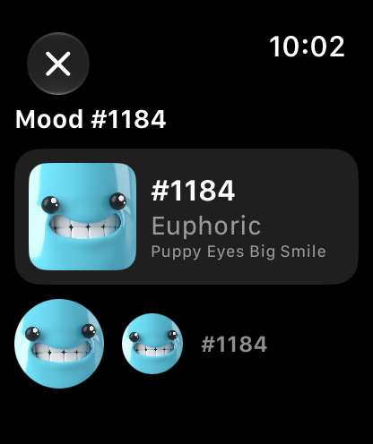

# MoodWatch for Apple Watch

The Apple Watch version of MoodWatch: a **Moods** app that shows any Moods NFT from Robinhood Chain full screen with the date and time over it, plus complications and a Smart Stack widget. It does the same things as the Wear OS app: pick a Mood by number, keep a Collection, pick a random one, and refresh every day after the 9:00 AM Pacific change.

<p align="center">
  
  &nbsp;
  
  &nbsp;
  
</p>
<p align="center">
  
  &nbsp;
  
  &nbsp;
  
  &nbsp;
  
</p>

Screenshots are from the Apple Watch Series 12 (46mm) simulator on watchOS 27.2.

## Why an app and complications, not a watch face

Apple doesn't let third-party apps make watch faces. So MoodWatch has two parts:

- **The Moods app.** Its main screen looks like the Wear OS face: the Mood edge to edge, with the date above a large time. In always-on mode the picture dims and the time keeps showing. Tap the screen to open the menu.
- **Complications and a Smart Stack widget.** These put your Mood on any Apple watch face that has complication slots (Modular, Infograph, Wayfinder, and others). Sizes: rectangular (image, `#id` and traits), circular (round image), corner (image with `#id`), and inline (`Mood #id`).

To keep the app on screen like a face, set it to stay open (see [Keep Moods on screen](#keep-moods-on-screen)). The face hides watchOS's corner clock, so the only time on that screen is the one drawn over the Mood. Menu screens still show the system clock.

## Requirements

- Xcode 15 or newer, with the watchOS SDK and a watchOS simulator runtime. The project uses the Swift 6 language mode and is tested with Xcode 27.2 and watchOS 27.2.
- [XcodeGen](https://github.com/yonaskolb/XcodeGen), which generates the Xcode project from `project.yml`.
- To run on a watch: watchOS 10 or newer, an iPhone paired with the watch, and an Apple ID (a free one works).
- Optional: the commercial Brice font. The app uses Fredoka unless you add Brice yourself; see [Fonts](../README.md#fonts).

## Build and run in the simulator

The Xcode project isn't committed. XcodeGen generates it from `project.yml`, so run `xcodegen generate` after you clone the repo and whenever you add or remove files.

1. Install XcodeGen once. In Terminal, from any folder:
   ```sh
   brew install xcodegen
   ```
2. If you just installed Xcode, open it once and accept the license. Then download a watchOS simulator, from any folder:
   ```sh
   export DEVELOPER_DIR=/Applications/Xcode.app/Contents/Developer
   xcodebuild -downloadPlatform watchOS
   ```
3. Build, install and launch. Choose one of these ways:
   - **Script.** From the repository root (`~/Projects/MoodWatch`):
     ```sh
     apple-watch/scripts/run-sim.sh
     ```
     It finds or creates an Apple Watch Series 12/11/10 (46mm) or Ultra simulator, boots it, builds into `apple-watch/build/`, then installs and launches Moods. Take a screenshot with `apple-watch/scripts/run-sim.sh shot face`; it's saved to `apple-watch/build/screenshots/face.png`.
   - **Xcode.** From the `apple-watch` folder:
     ```sh
     cd ~/Projects/MoodWatch/apple-watch
     xcodegen generate
     open MoodWatch.xcodeproj
     ```
     Choose the **MoodWatch** scheme and an Apple Watch simulator, then press ⌘R.
   - **Command line.** From the `apple-watch` folder:
     ```sh
     cd ~/Projects/MoodWatch/apple-watch
     export DEVELOPER_DIR=/Applications/Xcode.app/Contents/Developer
     xcodegen generate
     xcrun simctl list devices available | grep "Apple Watch"     # copy a UDID
     UDID=<the UDID>
     xcrun simctl boot "$UDID"
     xcodebuild -project MoodWatch.xcodeproj -scheme MoodWatch -configuration Debug \
       -destination "platform=watchOS Simulator,id=$UDID" -derivedDataPath build/DerivedData build
     xcrun simctl install "$UDID" build/DerivedData/Build/Products/Debug-watchsimulator/Moods.app
     xcrun simctl launch "$UDID" com.moodwatch.app.watch
     ```

To see the simulator's screen: Xcode 26 and older include **Simulator** (`open -a Simulator`). Xcode 27 replaces it with **DeviceHub** (`open /Applications/Xcode.app/Contents/Applications/DeviceHub.app`). The app also runs with neither open, and `xcrun simctl io "$UDID" screenshot face.png` still works.

If the watch shows a red crossed-out phone icon, the simulator's paired iPhone isn't running. Boot it too (`xcrun simctl list pairs` shows which one).

To debug the complication, run the **MoodsWidget** scheme in Xcode.

## Tests and debug launch arguments

The **MoodWatch** scheme has UI tests (`UITests/`) that drive the app in the simulator:

- `testChooseRandomAndCollection` types 555 on the number pad, adds and removes it from the Collection, runs Pick random three times and adds each Mood, then switches the face from a Collection row and swipes a row away.
- `testCollectionRowSwitchesFace` starts with a seeded Collection and checks that tapping a row changes the face.
- `testAddMoodsToModularFace` adds a Modular watch face and puts Moods in its large middle slot and its top-left slot. Each run adds one more Modular face to the simulator's face library.

Run them from the `apple-watch` folder. They need network access and take about 9 minutes. Screenshots are saved to `build/uitest-shots/`:

```sh
cd ~/Projects/MoodWatch/apple-watch
export DEVELOPER_DIR=/Applications/Xcode.app/Contents/Developer
xcodegen generate
mkdir -p build/uitest-shots
TEST_RUNNER_SCREENSHOT_DIR=$PWD/build/uitest-shots xcodebuild -project MoodWatch.xcodeproj -scheme MoodWatch \
  -destination "platform=watchOS Simulator,id=<UDID>" -derivedDataPath build/DerivedData test
```

Add `-only-testing:MoodWatchUITests/MoodWatchUITests` to skip the watch face test.

Debug builds also accept launch arguments that open a screen directly, which is how the screenshots above were taken. They're compiled out of Release builds (see `App/DebugLaunch.swift`):

| Argument | Effect |
|---|---|
| `-token 1184` | Loads that Mood. |
| `-screen menu`, `keypad`, `collection` or `widgets` | Opens that screen. `widgets` shows every complication size in the app. |
| `-seedCollection 904,1247,3094` | Replaces the Collection, newest first. |
| `-keypadDigits 555` | Pre-fills the number pad. |
| `-alwaysOn YES` | Shows the face dimmed, as in always-on mode. |

For example, from the repository root:

```sh
apple-watch/scripts/run-sim.sh launch -token 1184 -seedCollection 1184,349,3094,1247 -screen collection
apple-watch/scripts/run-sim.sh shot collection
```

## Add the complication or widget

<p align="center">
  
  &nbsp;
  
</p>

- **To a watch face:** touch and hold the face, tap **Edit**, swipe to **Complications**, tap a slot, and choose **Moods**.
- **To the Smart Stack:** on the watch face, turn the Digital Crown up (or swipe up). Touch and hold the stack, tap **+**, and choose **Moods**.

The app has to load a Mood before the complication shows it. Until then, the complication shows the default Mood.

## Keep Moods on screen

By default the watch returns to the watch face 2 minutes after you lower your wrist. To keep Moods on screen:

1. On the watch, open **Settings → General → Return to Clock**.
2. Scroll down, tap **Moods**, and turn on **Custom**. Choose **After 1 hour**, the longest option Apple allows.

The app supports always-on: when you lower your wrist, the picture dims and the time keeps updating.

## Install on your own watch

Without a paid Apple Developer account, you can install the app with a free Apple ID. The app then stops opening after **7 days**, and you have to install it again from Xcode.

1. Pair the watch with your iPhone, and connect the iPhone to your Mac with a cable, or have both on the same Wi-Fi network.
2. Turn on Developer Mode on the iPhone: **Settings → Privacy & Security → Developer Mode**. Do the same on the watch (**Settings → Privacy & Security → Developer Mode**). The option shows up after Xcode has seen the device. Each device restarts.
3. In Xcode, open **Settings → Accounts** and add your Apple ID.
4. Open `MoodWatch.xcodeproj`. For both the **MoodWatch** and **MoodsWidget** targets, open **Signing & Capabilities** and choose your team (for example, "Your Name (Personal Team)").
5. Bundle IDs and App Group IDs must be unique to your account. If Xcode says `com.moodwatch.app.watch` isn't available, change the IDs in `project.yml` (`PRODUCT_BUNDLE_IDENTIFIER` for both targets, and the App Group in both `entitlements` blocks). Also change `Moods.appGroup` in `Shared/Moods.swift`, then run `xcodegen generate` again. The widget's bundle ID must start with the app's bundle ID.
6. Choose your watch as the run destination and press ⌘R. The first install over Wi-Fi can take several minutes.

If you choose your team in Xcode, `xcodegen generate` resets that choice. To keep it, add `DEVELOPMENT_TEAM: <your team ID>` under `settings: base:` in `project.yml`.

## How it works

| Folder | What it is |
|---|---|
| `App/` | The watchOS app (SwiftUI): the face screen (`FaceView`), the menu, the number pad, the Collection, and background refresh (`DriftScheduler`). |
| `Widget/` | The WidgetKit extension: the complications and Smart Stack widget. Debug builds of the app also include `MoodWidgetViews.swift` for the `-screen widgets` gallery. |
| `UITests/` | XCUITest UI tests for the app and the complication. |
| `Shared/` | Code built into both targets: the contract and metadata calls (`MoodAPI`), the load/refresh logic (`MoodRepository`), storage (`MoodStore`), and the Pacific-time schedule (`DriftClock`). It only uses Foundation and ImageIO, so it also builds for macOS with `swiftc`. |
| `project.yml` | The XcodeGen spec. App bundle ID `com.moodwatch.app.watch`, widget `com.moodwatch.app.watch.widget`, App Group `group.com.moodwatch.app`. |
| `scripts/run-sim.sh` | Builds and runs the app in the simulator, and takes screenshots. |

Fetching works like the Wear OS app. The first lookup calls `tokenURI` on the contract and remembers the metadata URL prefix, so later lookups skip the chain. A 512 px copy of the image comes from the [wsrv.nl](https://wsrv.nl) proxy (120 px for Collection thumbnails), with the original image as a fallback. A new Mood only replaces the current one after its image has downloaded, and only the latest request is saved.

The app and the widget share data through the App Group: settings in its UserDefaults, and `current.jpg`, `info.json` and `collection/<id>.jpg`/`.json` in its container.

### Daily refresh

Moods change expression around 9:00–9:15 AM Pacific.

- **App:** the app schedules a background refresh for 9:05 AM Pacific. If the image hasn't changed yet, it tries again every 3 minutes until 9:30. When the app is open during that window, it also checks once a minute. When you open the app, it refreshes if its Mood is out of date.
- **Widget:** the widget reloads shortly after 9:05 AM and fetches the new image itself if the app hasn't already. Until the change arrives, it reloads every 10 minutes.

watchOS decides when background work actually runs. Updates come sooner if a Moods complication is on your active watch face, and can be late or skipped if it isn't, or when the battery is low. Opening the app always catches up.
